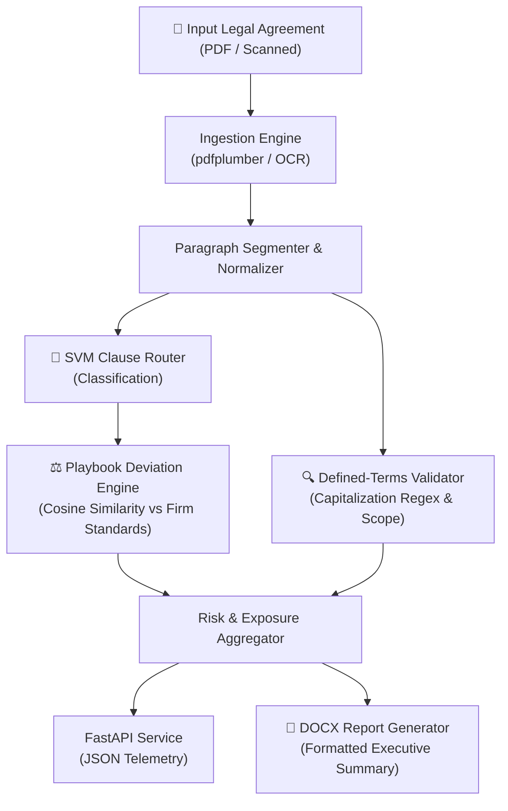

# Contract-Analyzer-ML 📄⚖️

[](https://github.com/Rib4ko/Contract-Analyzer-ML/actions/workflows/ci.yml)
[](https://www.python.org/)
[](https://fastapi.tiangolo.com)
[](https://scikit-learn.org/)
[](LICENSE)

An intelligent, local-first legal contract audit and compliance classification pipeline. Designed for automated transactional review, clause extraction, playbook deviation detection, defined-terms verification, and instant Microsoft Word (`.docx`) audit reporting.

---

## 🌟 Key Features

- **📑 Multi-Source Ingestion & OCR:** Extracts clean document structures and paragraphs from native digital PDFs (`pdfplumber`) and scanned paper agreements via OCR engine integration.
- **🧠 Machine Learning Clause Routing:** Employs pre-trained linear SVM and TF-IDF pipelines to classify incoming contract provisions into standardized taxonomy categories (Indemnification, Confidentiality, Governing Law, Termination, etc.).
- **⚖️ Playbook Deviation & Risk Scoring:** Compares classified provisions against custom firm negotiation standards using cosine similarity metrics to flag high-risk alterations.
- **🔍 Defined-Terms Integrity Validator:** Two-pass AST and regex normalization that identifies all capitalized capitalized terms across the agreement and flags terms used without proper definitions.
- **📊 Automated Executive Word (.docx) Reporting:** Generates client-ready executive audit documents summarizing legal exposure, risk matrices, and missing definition tables.
- **⚡ High-Throughput REST API:** Built on FastAPI with asynchronous endpoints for batch document ingestion and report compilation.

---

## 📐 Architecture Pipeline



---

## 🚀 Quickstart & Installation

### 1. Environment Setup

```bash
# Clone the repository
git clone https://github.com/Rib4ko/Contract-Analyzer-ML.git
cd Contract-Analyzer-ML

# Create & activate virtual environment
python -m venv venv
# Linux / macOS:
source venv/bin/activate
# Windows:
.\venv\Scripts\activate

# Install core dependencies
pip install -r requirements.txt
```

### 2. Launch FastAPI Microservice

```bash
uvicorn src.api.app:app --host 0.0.0.0 --port 8001 --reload
```

- **Interactive API Docs:** `http://localhost:8001/docs`
- **Health Check:** `http://localhost:8001/health`

---

## 🧪 Testing & Validation

Execute the automated test suite:
```bash
pytest -v
```

---

## 📄 License
Distributed under the MIT License. See [LICENSE](LICENSE) for more details.
